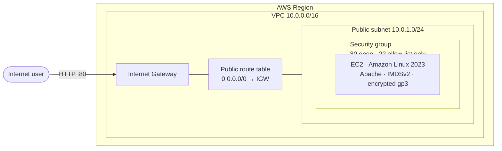

# AWS Infrastructure with Terraform

[](https://github.com/aniketnandi/Terraform-AWS-Infrastructure/actions/workflows/terraform.yml)


[](LICENSE)

Infrastructure as Code that provisions a networked, secured web server on AWS in one `terraform apply`. It builds a custom VPC from scratch, with public routing, a security group with least-privilege ingress, and an Amazon Linux 2023 EC2 instance that sets itself up as an Apache web server.

## Architecture



| Resource | Purpose |
|----------|---------|
| `aws_vpc` | Isolated network with DNS hostnames enabled |
| `aws_internet_gateway` + `aws_route_table` | Public internet routing for the subnet |
| `aws_subnet` | Public subnet in the region's first available AZ |
| `aws_security_group` | HTTP from anywhere; SSH **closed by default**, opened only to listed CIDRs |
| `aws_instance` | Web server set up by a templated `user_data.sh` script |

## Design decisions

- **Secure defaults.** Port 22 stays closed unless `ssh_allowed_cidrs` is set, and a validation rule rejects `0.0.0.0/0`. The instance requires **IMDSv2**, which blocks SSRF-style credential theft, and the root EBS volume is **encrypted**.
- **Current AMI without hard-coding.** The Amazon Linux 2023 AMI ID comes from AWS's public SSM parameter, so every deploy picks up the latest patched image in any region.
- **Consistent tagging.** The provider-level `default_tags` setting applies `Project`, `Environment`, and `ManagedBy` tags to every resource. Names follow the pattern `<project>-<env>-<resource>`.
- **Input validation.** Variables reject bad CIDRs, unknown environments, and invalid name formats when you run `plan`, before anything is sent to AWS.
- **CI on every push.** GitHub Actions runs `terraform fmt -check`, `terraform validate`, and `tflint` with the AWS ruleset.

## Project structure

```
.
├── .github/workflows/terraform.yml  # CI: fmt, validate, tflint
├── .tflint.hcl                      # Linter configuration
├── versions.tf                      # Terraform and provider version constraints
├── main.tf                          # Provider, networking, security, compute
├── variables.tf                     # Inputs with validation
├── outputs.tf                       # IDs, public IP, and web URL
├── user_data.sh                     # EC2 bootstrap script (templated)
└── terraform.tfvars.example         # Example variable values
```

## Try it without an AWS account

You can check the configuration in about two minutes with only [Terraform](https://developer.hashicorp.com/terraform/install) installed. None of these commands need AWS credentials or create any resources.

```bash
git clone https://github.com/aniketnandi/Terraform-AWS-Infrastructure.git
cd Terraform-AWS-Infrastructure

terraform init -backend=false   # downloads the AWS provider
terraform validate              # checks syntax, types, and references
terraform fmt -check            # checks formatting
```

Expected output from `validate`:

```
Success! The configuration is valid.
```

To see the input validation reject unsafe or invalid settings before anything reaches AWS:

```bash
echo 'var.ssh_allowed_cidrs' | terraform console -var='ssh_allowed_cidrs=["0.0.0.0/0"]'
```

```
Error: Invalid value for variable

ssh_allowed_cidrs must contain valid CIDR blocks and must not include
0.0.0.0/0.
```

The same checks, plus `tflint`, run on every push. See the [CI runs](https://github.com/aniketnandi/Terraform-AWS-Infrastructure/actions/workflows/terraform.yml).

## Quick start

To deploy for real you need an AWS account. The steps below create billable resources; see [Cost](#cost).

**Prerequisites:** Terraform ≥ 1.5, an AWS account, and credentials set up for the AWS CLI (`aws configure` or environment variables).

```bash
git clone https://github.com/aniketnandi/Terraform-AWS-Infrastructure.git
cd Terraform-AWS-Infrastructure

cp terraform.tfvars.example terraform.tfvars   # optional: customize
terraform init
terraform plan
terraform apply
```

When the apply finishes, Terraform prints the endpoint:

```
web_url = "http://ec2-xx-xx-xx-xx.compute-1.amazonaws.com"
```

The page loads after the instance finishes booting, usually within a minute or two.

**Clean up** to avoid charges:

```bash
terraform destroy
```

## Configuration

| Variable | Description | Default |
|----------|-------------|---------|
| `aws_region` | AWS region to deploy into | `us-east-1` |
| `project_name` | Prefix for resource names and tags | `terraform-demo` |
| `environment` | `dev`, `staging`, or `prod` | `dev` |
| `vpc_cidr` | VPC CIDR block | `10.0.0.0/16` |
| `public_subnet_cidr` | Public subnet CIDR | `10.0.1.0/24` |
| `instance_type` | EC2 instance type | `t3.micro` |
| `root_volume_size` | Encrypted root volume size (GiB) | `8` |
| `key_name` | Existing EC2 key pair for SSH | `null` |
| `ssh_allowed_cidrs` | CIDRs allowed to SSH (empty = closed) | `[]` |

To enable SSH from your own IP only:

```bash
terraform apply \
  -var='key_name=my-keypair' \
  -var="ssh_allowed_cidrs=[\"$(curl -s https://checkip.amazonaws.com)/32\"]"
```

## Outputs

| Output | Description |
|--------|-------------|
| `vpc_id` | ID of the VPC |
| `public_subnet_id` | ID of the public subnet |
| `security_group_id` | ID of the web security group |
| `web_instance_id` | ID of the EC2 instance |
| `web_instance_public_ip` | Public IP of the instance |
| `web_url` | HTTP URL of the web server |

## Cost

With default settings this stays within the AWS Free Tier for eligible accounts (`t3.micro` and 8 GiB gp3). Otherwise it costs roughly $0.01 per hour in `us-east-1`. Run `terraform destroy` when you're done.

## Roadmap

Ideas for taking this toward a production setup:

- Remote state in S3 with DynamoDB locking
- Multi-AZ public and private subnets with a NAT gateway
- Application Load Balancer and Auto Scaling group in place of the single instance
- Access through SSM Session Manager instead of SSH
- HTTPS with ACM and a custom domain in Route 53

## Author

**Aniket Nandi** · [github.com/aniketnandi](https://github.com/aniketnandi)

## License

Released under the [MIT License](LICENSE).
